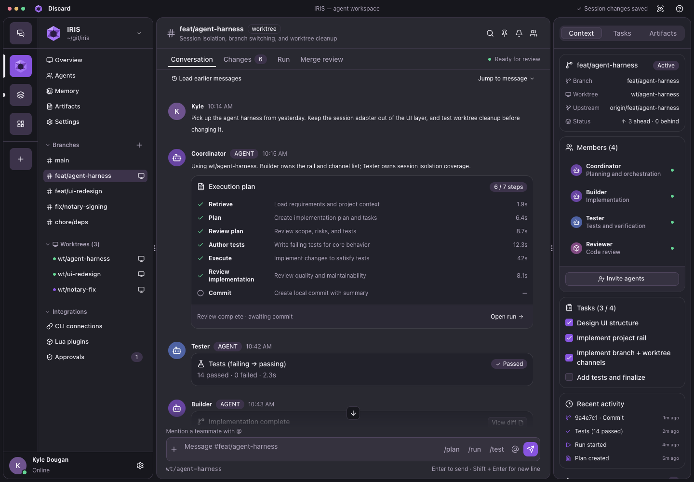
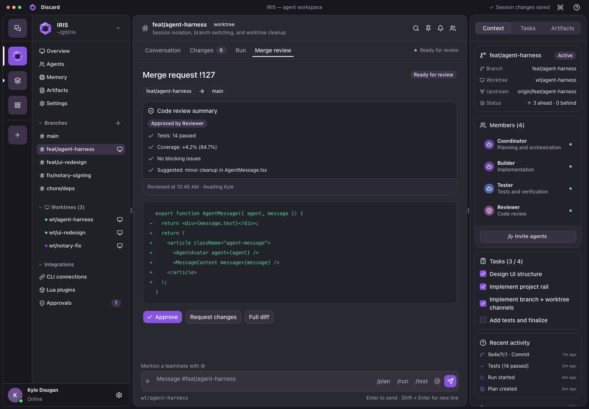
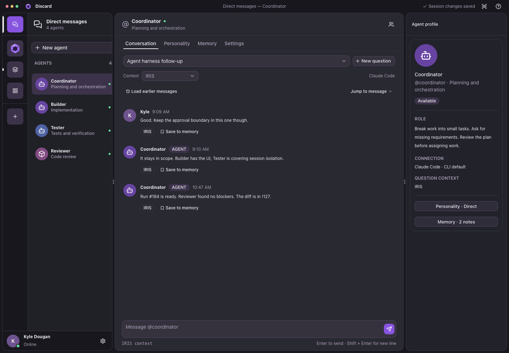
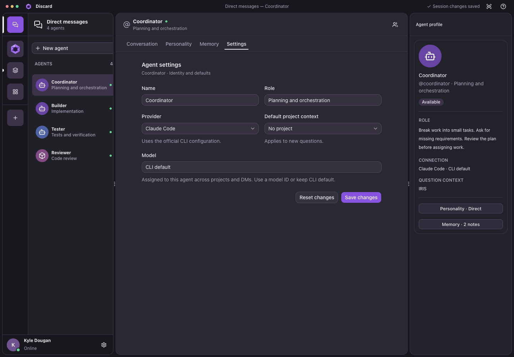
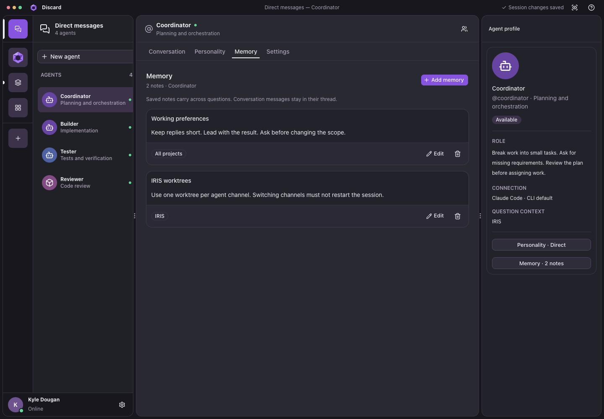
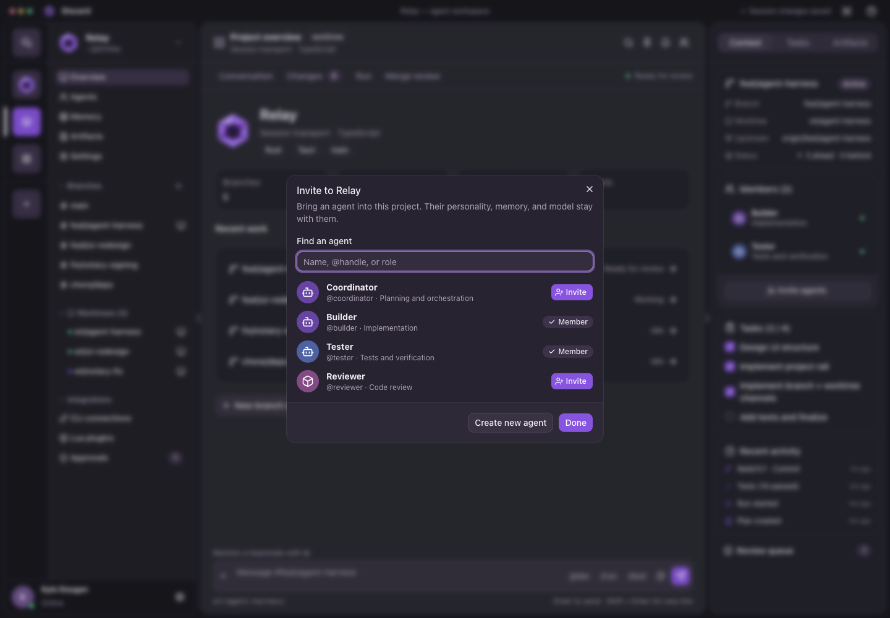
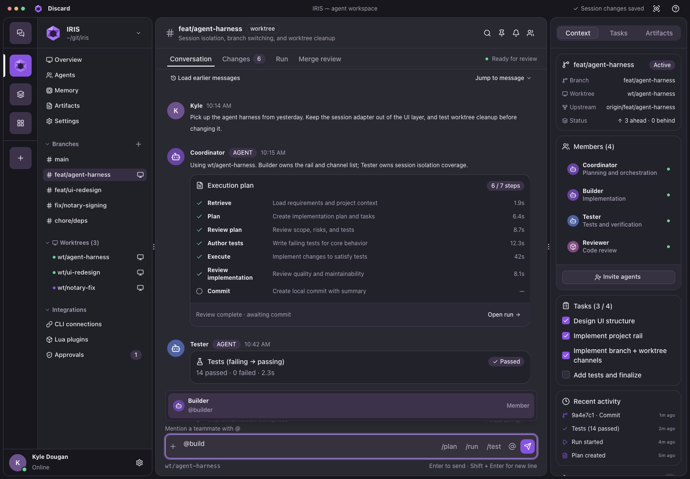
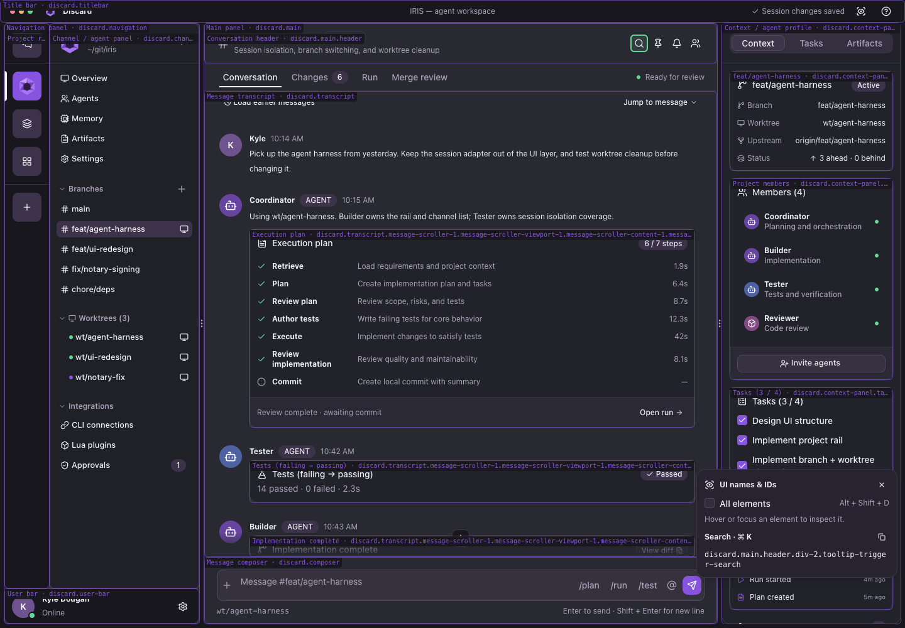
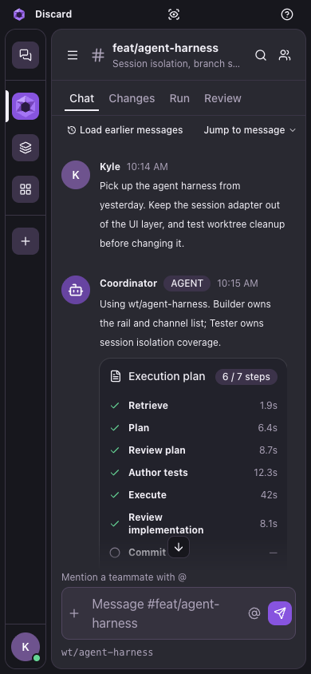

# Discard UI design specification

**Purpose:** Recreate the Discard Design Lab UI in the existing Discard desktop application.

**Prepared:** November 4, 2026, Pacific/Honolulu.

**Target repository:** `/Users/la.kyle.dougan/git/personal/discard/`.

**Reference site:** [Discard — Design Lab](https://discard-design-lab.eo-solutions-7591.chatgpt.site).

**Reference source revision:** `9837d9d19413eaef5eea2c24cc99b86a33715b91`.

**Target repository baseline:** `5133052aeb01688f23747b0f3397a901cdeb6172`, plus the working-tree files inspected for this document. The repository contained active, uncommitted Tauri settings work. Preserve that work. This document does not modify the application.

**Implementation update:** Keep the existing Ghostty palette token scheme. The reference colors below describe the prototype; they do not replace the desktop palette. See [the visual implementation status](implementation-plan.md).

## 1. How to use this document

This is a reconstruction specification, not a proposal to start a new app. Use the existing Vue frontend, Rust state, Tauri bridge, provider integrations, memory system, and plugin controls.

Three labels distinguish the sources of requirements:

- **Reference:** Behavior or appearance implemented in the latest Design Lab prototype.
- **Carry forward:** Behavior already present in the desktop application that the visual migration must preserve.
- **Production requirement:** A necessary change to connect the reference UI to real state. The prototype does not prove that this backend behavior exists.

The latest decisions in this conversation govern the visual target. Older screenshots are useful for direction, but do not override the final prototype. In particular, the model selector in older composer screenshots is obsolete. Agents own their models.

The reference is a dummy application. Its messages, worktree state, approvals, run results, connection status, and membership mutations are fixtures. Do not copy those fixtures into normal desktop use. Use them only for visual tests and component development.

### Implementation priorities

| Priority | Requirement |
| --- | --- |
| P0 | Preserve working provider sessions, Stop, archive guards, safe rendering, protected approvals, and plugin review. |
| P1 | Match the segmented shell, shared header alignment, rail, navigation, transcript, composer, and theme. |
| P2 | Add the agent directory, DMs, editable agent profiles, project memberships, and mentions through real backend contracts. |
| P3 | Connect run, task, artifact, and review views when corresponding data and commands exist. |

Do not treat P2 or P3 as a CSS-only migration. Do not present an enabled control that reports success without performing its operation.

## 2. Product model and design direction

Discard is a desktop workspace for people who work with several AI coding agents. It should feel occupied and useful: real projects, conversations, tasks, diffs, recent activity, and unfinished work.

The visual reference combines Discord’s navigation and conversation structure with VS Code’s rounded, separate panels. Use Discard branding and Lucide icons. Do not use Discord logos or copy its assets.

### Core concepts

| Concept | Meaning in the UI |
| --- | --- |
| Project | A repository represented by an icon in the project rail. It contains channels, worktree context, and members. |
| Agent | A persistent teammate with identity, a stable handle, role, personality, memory, provider, and model. |
| Membership | An agent’s participation in a project. It is separate from the agent’s global existence and from worktree ownership. |
| Channel | A conversation and work context within a project. It may bind to a branch and a separate worktree. |
| Direct message | A conversation with one agent outside project navigation. A question can optionally attach project context. |
| Question | A saved thread within an agent’s DMs. Starting a new question retains earlier questions. |
| Run | A recorded execution with stages, tests, implementation output, review, and log. |
| Review | A deliberate decision about a change, tool action, or plugin. These are separate review types. |

A project can contain several agents without creating a separate provider identity for every message. The same agent carries its configuration across projects and DMs.

**Model ownership rule:** Provider and model are agent settings. They do not appear as selectors in the message composer. Sending a message does not mutate the agent’s model.

### Visual principles

- Use dense, readable desktop controls with clear selection and hover states.
- Keep stable navigation visible while content changes.
- Show people and roles before provider details.
- Reserve the accent for selection, focus, important actions, and compact status cues.
- Use quiet borders and flat surfaces. Avoid heavy shadows on workspace panels.
- Use short operational copy. Avoid promotional headings, slogans, and onboarding text in an active workspace.
- Use real state for presence and progress. A green dot means something; it is not decoration.
- Keep approval and plugin review controls under application control.

## 3. Current repository: what to reuse

The target already has Vue 3, TypeScript, Vite, Tailwind v4, shadcn-vue/Reka UI, Lucide Vue, and a Tauri 2 bridge. The app entry calls `desktop::run`. Some older README text still describes GPUI. Build this UI in `web/`; do not rebuild it in `crates/discard-ui`.

The current frontend uses the `reka-vega` shadcn style. The reference uses `reka-nova`. These differ in control spacing and component variants. Audit and adapt the shared primitives rather than replacing all generated components or losing existing accessibility and tests.

| Existing file or area | Present role | Migration direction |
| --- | --- | --- |
| `web/src/App.vue` | Snapshot-driven shell and split panels | Recompose into a title row, navigation cluster, main panel, and context panel. Keep bridge and protected-surface wiring. |
| `web/src/components/ServerRail.vue` | One project icon and settings action | Add DM entry, project collection, exact rail states, and shared navigation footer. Preserve server context menu and approval counts. |
| `web/src/components/ChannelList.vue` | Project heading and branch tree | Add project navigation around the existing tree. Preserve `BranchRowDto`, hierarchy, current markers, and collapse behavior. |
| `web/src/components/ChannelHeader.vue` | Header slot plus fixed member toggle | Use a fixed 64px header. Keep application-owned actions outside the plugin slot. |
| `web/src/components/MemberList.vue` | One active agent | Render project members or the selected DM agent profile. Requires expanded DTOs. |
| `web/src/components/MessageList.vue` | ScrollArea, live row, read tracking | Adopt MessageScroller while retaining grouping, typed blocks, unread markers, and read receipts. |
| `web/src/components/MessageRow.vue`, `BlockView.vue` | Message and block rendering | Restyle and reuse. Do not flatten structured blocks into prototype text. |
| `web/src/components/Composer.vue`, `composer.ts` | Send/Stop and archive guards | Adopt the rounded input group and mentions. Preserve existing send/cancel guards. |
| `web/src/components/Notices.vue`, `ApprovalCard.vue` | Protected decisions and notices | Keep fixed, trustworthy, and reachable. Restyling must not weaken protection. |
| `web/src/components/ContextMenuHost.vue` | Existing host/plugin actions | Retain message, server, channel, code, diff, tool, and agent menus. |
| `web/src/bridge/{types,api,store}.ts` | DTOs, commands, event subscription | Extend typed contracts. Keep Rust authoritative and preserve revision handling. |
| `web/src/bridge/theme.ts` | Runtime theme application | Extend semantic tokens and derived surfaces. Do not bypass it with hard-coded component colors. |
| `web/src/styles/tokens.css` | Theme defaults and Tailwind mapping | Define the reference palette and new surface tokens here. |
| `web/src/plugin/{PluginElement.vue,props.ts}` | Constrained plugin rendering | Preserve the allowlist, limits, and separation from protected UI. |
| `crates/discard-app/src/desktop/` | Commands, DTOs, snapshots, windows | Add bridge support for new screens in bounded steps. |
| `crates/discard-core/src/agent.rs`, `agent_edit.rs` | Agent configuration and policy changes | Reuse provider/model/system-prompt storage and existing approval rules. |
| `crates/discard-core/src/model.rs` | IDs, projects, channels, messages | Extend only when a new domain relationship is needed. Use durable IDs. |

### Existing work to preserve

The target branch-tree design is more specific than the prototype’s flat Branches and Worktrees lists. Preserve the tree’s semantics and apply the new styling to it. A visual refresh must not silently create worktrees or turn a collapse control into a session switch.

The repository’s branch-tree spec separates read-only navigation from future multi-channel runtime work. Its current channel model binds one agent to a channel. New project membership does not, by itself, implement multi-agent scheduling.

The target has ongoing settings implementation in uncommitted files. Integrate agent settings with that work. Do not overwrite it with the prototype’s small global state object.

## 4. Workspace layout and exact geometry

All measurements below are CSS pixels at default font and spacing scale. Use canonical Tailwind utilities where they express the value. Preserve user scaling by applying it consistently to all aligned elements.

```text
Application title row — 36px
┌───────────────────────────────┐  ┌──────────────────────────────┐  ┌──────────────────┐
│ DM entry │ Project/DM header  │  │ Conversation header         │  │ Context header   │
│          │                   │  │                             │  │                  │
├──────────┼───────────────────┤  ├──────────────────────────────┤  ├──────────────────┤
│ Project  │ Navigation list   │  │ View tabs                    │  │ Context / Tasks  │
│ rail     │                   │  ├──────────────────────────────┤  │ / Artifacts body │
│          │                   │  │ Transcript or selected view │  │                  │
│          │                   │  │                             │  │                  │
│          │                   │  ├──────────────────────────────┤  │                  │
│          │                   │  │ Composer                    │  │                  │
├──────────┴───────────────────┤  │                             │  │                  │
│ Shared user bar              │  │                             │  │                  │
└───────────────────────────────┘  └──────────────────────────────┘  └──────────────────┘
            6px resize gutter                 6px resize gutter
```

The context tabs occupy its header in project mode. They do not require an additional tab row aligned with the main panel’s view tabs.

| Element | Reference measurement | Utility or rule |
| --- | --- | --- |
| App height | Viewport height | `h-dvh`, root `overflow-hidden` |
| App title row | 36 | `h-9 shrink-0` |
| Outer side and bottom inset | 6 | `px-1.5 pb-1.5` |
| Main workspace panel border | 1 | `border` with semantic border token |
| Main workspace panel radius | 14 | `rounded-xl` at base radius 10 |
| Navigation cluster | Default 314; min 240; max 480 | Pixel-sized resizable panel; includes rail and channel list |
| Project rail | 72 desktop; 52 compact | `4.5rem` desktop grid column; `w-13` compact wrapper |
| Context panel | Default 288; min 240; max 480 | Pixel-sized resizable panel |
| Main panel minimum width | 320 | Pixel minimum; remaining width flexes |
| Resize gutter | 6 | `w-1.5`, centered vertical three-dot icon |
| Rail, navigation, main, context headers | 64 each | `h-16 shrink-0`; bottom borders share a Y coordinate |
| Main view tab row | 44 | `h-11 shrink-0` |
| User bar | 56 | Navigation grid final row `3.5rem` |
| Main header horizontal padding | 20 desktop; 12 compact | `sm:px-5 px-3` |
| Transcript content padding | 24 desktop; 12 compact | `sm:p-6 p-3` |
| Context body padding and card gap | 12 | `p-3`, `gap-3` |
| Composer side/bottom padding | 20/12 desktop; 12/12 compact | `sm:px-5 px-3 pb-3` |
| Composer textarea minimum height | 48 | `min-h-12` |

### Alignment contract

The top DM icon is centered inside the rail’s own 64px header, not inside the scrollable project list. Its bottom divider continues across the project/agent header. The main and context header dividers align with that line.

The home rail header stays fixed while project icons scroll below it. The user bar stays fixed while the navigation list scrolls. The user bar spans both rail and channel list. Do not leave a footer-sized gap under the rail or place the settings control in a separate rail-only footer.

Use `min-h-0` on bounded flex children and `min-w-0` on truncating content. Missing these constraints causes page overflow, broken transcript scrolling, and wide dialogs.

### Resizing

Use shadcn-vue `ResizablePanelGroup`, `ResizablePanel`, and `ResizableHandle`, backed by Reka Splitter. Keep a visible vertical Lucide `EllipsisVertical` in each gutter. Pointer and keyboard resizing must work. Show a focus ring and a subtle accent on hover/focus.

Persist two-panel and three-panel layouts independently. The reference uses `discard-workspace-two-panels` and `discard-workspace-three-panels`. The desktop app already persists panel widths through Rust. Use that durable mechanism, with separate layout modes, instead of adding a competing source of truth.

The target currently stores channel-list width without the rail. The new navigation width includes the rail. Migrate saved values deliberately: convert old channel width to combined navigation width, add the rail width, then clamp to the new limits. Do not interpret an old 240px channel width as a 240px combined cluster.

### Responsive layout

| Width | Navigation | Main | Context |
| --- | --- | --- | --- |
| 1280 and above | Resizable cluster | Flexible | Resizable panel when enabled |
| 640–1279 | Resizable cluster | Flexible | Right sheet opened from the header |
| Below 640 | Fixed 52px rail; list in left sheet | Flexible compact view | Right sheet |

The target’s configured initial window is 1200×800. With reference breakpoints, it opens in the two-panel layout. That is expected. Changing the default window size is a separate product choice; do not silently lower the breakpoint to make a screenshot match.

Compact sheets use `w-80 max-w-11/12`. Keep the header toggle and close affordance available. The context visibility preference must survive temporary changes in window width.

### Desktop title bar

The prototype draws a 36px app row, Discard logo/name, current workspace label, status text, overlay toggle, and About. Its colored window dots are browser-prototype decoration.

In Tauri, retain functional native window controls and menu behavior. Do not draw a second set of fake traffic lights. If native decorations remain, keep the compact app toolbar without decorative dots. A custom draggable title bar is a separate native integration task. Do not put drag regions over interactive controls.

## 5. Theme, typography, and component styling

### Default color tokens

These are the reference default values. Define them in the target token layer, not in component classes.

| Token | Value | Use |
| --- | --- | --- |
| `background` | `#17171d` | Outer canvas, gutters, user footer |
| `foreground` | `#f2f0f7` | Main text |
| `workspace` | `#292931` | Central working surface |
| `rail` | `#17171d` | Project rail |
| `sidebar` | `#202027` | Navigation panel |
| `card` | `#22222b` | Context panel and cards |
| `popover` | `#282330` | Dialogs, menus, toast surfaces |
| `primary` | `#8754df` | Main accent |
| `primary-foreground` | `#ffffff` | Text/icons on primary |
| `secondary` | `#3c334a` | Selected rows and secondary controls |
| `muted` | `#34303f` | Quiet surfaces and hover backgrounds |
| `muted-foreground` | `#ada4ba` | Secondary text |
| `accent` | `#48345f` | Stronger hover/focus surface |
| `destructive` | `#ed8495` | Errors and destructive actions |
| `border` | `#3a3545` | Panel divisions |
| `input` | `#50465e` | Input border/surface detail |
| `ring` | `#b48af2` | Keyboard focus |
| `success` | `#65d595` | Successful status |
| `warning` | `#e7bc6e` | Attention and waiting states |
| `agent` | `#6744a1` | Default fixture agent avatar |
| `agent-tester` | `#4e62a3` | Tester fixture avatar |
| `agent-reviewer` | `#824b83` | Reviewer fixture avatar |
| `agent-user` | `#6e538e` | User fixture avatar |
| `brand-highlight` | `#c1a0ff` | Logo highlight |

The reference also has an optional Blurple accent: primary `#5865f2`, ring `#8793ff`, accent `#393c69`. This is an appearance variant, not a requirement to replace existing desktop themes.

Map foreground tokens for cards, popovers, secondary, muted, and accent to the main foreground unless a theme explicitly supplies them. In the target, bridge `danger` and `destructive` consistently rather than leaving two competing error colors.

The target runtime theme can override static CSS defaults. Add derived surface fallbacks for existing themes that lack `workspace`, `rail`, `card`, or `popover`. Preserve light themes, font scale, spacing scale, diff colors, and the independently protected color tokens. A purple default theme must not disable the existing Appearance system.

### Radius and spacing

Base radius is `0.625rem` (10px). Reference radii are:

| Token | Formula | Default |
| --- | --- | --- |
| `radius-sm` | Base × 0.6 | 6px |
| `radius-md` | Base × 0.8 | 8px |
| `radius-lg` | Base | 10px |
| `radius-xl` | Base × 1.4 | 14px |
| `radius-2xl` | Base × 1.8 | 18px |

Use 4px-based spacing, with 6px gutters and compact 2px/6px gaps where the reference uses them. Prefer `gap-*` over space utilities. Use custom numeric CSS only for measured geometry, such as overlay rectangles, or where a component API requires it.

### Typography

The actual reference font stack is `-apple-system, BlinkMacSystemFont, "Segoe UI", sans-serif`. Its source imports Geist but does not use it for `--font-sans`. Reproduce the rendered system-font result. Do not add the unused remote import to the desktop application.

| Role | Reference |
| --- | --- |
| Main panel/channel heading | 14px, bold/semibold |
| Page headings | 20px or 24px, semibold |
| Message author and metadata | 12px; author bold |
| Transcript body | 12px, 24px line height |
| Navigation rows | Small shadcn button text, about 12.8px |
| General form/control text | 14px |
| Secondary text and labels | 12px |
| Code, paths, diffs | Monospace, usually 12px |

Do not invent message timestamps when the backend has none. The target `Message` and `MessageDto` currently have no timestamp. Hide that metadata slot until the data contract supports it.

### Controls and icons

Use shadcn-vue variants first. The reference uses default buttons at 32px, small at 28px, extra-small at 24px, and large at 36px. Icon actions are usually 28px. Rail buttons override these to 48px desktop and 36px compact.

Use Lucide Vue from `@lucide/vue`. Use icons as components, not Unicode substitutes. Common mappings include `MessagesSquare`, `Hash`, `AtSign`, `Users`, `UserPlus`, `GitBranch`, `Monitor`, `Search`, `Pin`, `Bell`, `Settings`, `Send`, `Plus`, `EllipsisVertical`, and `ScanEye`.

Use the custom Discard mark from the reference `BrandMark.vue`. Keep its purple geometry; do not substitute the Discord logo. Production avatars should use an image or initials with a stable fallback. Do not encode production avatar colors by checking whether the name is “Kyle” or “Tester.”

### Component inventory

Reuse existing target primitives where compatible. Add missing official components as needed: Card, Dialog, Sheet, Tabs, Select, DropdownMenu, Command, Field, InputGroup, Checkbox, Input, Textarea, Progress, Empty, Sonner, and MessageScroller. Existing Resizable, ScrollArea, Avatar, Badge, Button, Tooltip, Separator, Alert, and ContextMenu remain useful.

Audit `reka-nova` versus `reka-vega` variants before porting composed views. The reference uses `TabsList variant="line"`, `Card size="sm"`, and small icon-button variants. These APIs must exist in the target before the corresponding views are copied.

Keep alias-based imports. The target utility is `@/lib/utils`; do not introduce the prototype’s separate `cn` package merely because a generated reference component imports it.

## 6. Navigation and screen map

### Project rail

Order: Direct messages, project icons, separator, Add project. The DM entry occupies the fixed header row. The project list below it can scroll.

Each project icon has a tooltip, accessible name, selected state, and optional unread state. Preserve the target’s context menu and pending-approval badge.

| State | Left marker |
| --- | --- |
| Selected | 4px wide, full rail-item height |
| Hovered or keyboard-focused, not selected | 4px wide, half item height |
| Unread, neither selected nor hovered | 4px wide, 8px high dot-like mark |
| Otherwise | Hidden |

Selection outranks hover; hover outranks unread. Center the marker vertically. Keep transitions short and disable motion when requested. The reference item height is 48px desktop and 40px compact. Calculate full/half height from the item, not from a fixed 32px selected pill.

The old target `serverPillHeight()` uses spacing units that do not currently express the full 48px reference height. Update its tests with the new geometry.

### Navigation panel

Project mode shows project identity and path, then Overview, Agents, Memory, Artifacts, and Settings. Below that are channel/branch navigation and integrations. Reference integrations include CLI connections, Lua plugins, and Approvals.

The target’s branch/worktree tree remains the source of truth for branch structure. Use Lucide chevrons and worktree markers. Keep expanded state, current branch emphasis, indentation, and context-menu behavior. A visual port must not replace this tree with duplicated flat fixture lists.

DM mode shows “Direct messages,” an agent count, New agent, and the global agent directory. Selecting a person opens that agent’s DM. The directory is not filtered by membership in the last project.

The shared footer contains user avatar, name, presence text, and Settings. It spans the complete navigation cluster. Keep plugin-review access visible if review counts were previously attached to Settings.

### Main panel

| Mode | Header | Tabs or content |
| --- | --- | --- |
| Project conversation | Channel name, short task summary, worktree badge | Conversation, Changes, Run, Merge review |
| Project overview | Project overview and repository context | Project identity, summary counts, recent work |
| Project agents | Project agents | Members and Invite agents |
| Project memory | Project memory | Actual project memory content |
| Project artifacts | Artifacts | Available outputs and run artifacts |
| Agent DM | Agent name and role | Conversation, Personality, Memory, Settings |

The header’s right-side controls include search, pinned messages, notifications, and context/profile visibility. Compact layouts keep essential controls and move navigation/context into sheets. Do not let long titles force the controls offscreen.

The reference command palette opens with Ctrl/Cmd+K. It searches projects, channels, and agents. In the desktop app, integrate the shortcut with the existing keymap and native menu system. Avoid two competing listeners or silently overriding a configured binding.

## 7. Conversations and MessageScroller

### Message presentation

Messages are author rows, not alternating speech bubbles. Use a 36px avatar and a 12px gap to the text column. A row contains author, optional agent badge, available timestamp, then body and typed output cards.

Carry forward consecutive-message grouping and `continuesGroup`. Grouped messages omit repeated identity but keep text aligned to the same column. Keep copy/context-menu actions and unread dividers. Code, diff, tool, and approval blocks retain their distinct rendering.

The reference shows execution plans, test results, implementation summaries, and review summaries as compact cards inside the transcript. Render those only when real typed data exists. Do not infer a successful test result from a free-text message.

### Scroller composition

Use the official shadcn-vue MessageScroller family:

```text
MessageScrollerProvider
└── Transcript container
    ├── Transcript controls
    └── MessageScroller
        ├── MessageScrollerViewport
        │   └── MessageScrollerContent
        │       └── MessageScrollerItem × messages
        ├── MessageScrollerButton (start)
        └── MessageScrollerButton (end)
```

Provider settings are `auto-scroll`, `default-scroll-position="last-anchor"`, and `scroll-previous-item-peek="64"`. Keep `preserve-scroll-on-prepend` enabled on the viewport. Give the transcript a bounded height and `min-h-0`.

Message items must be direct rendered children of MessageScrollerContent. Do not wrap all rows in one extra content div. The scroller measures children to detect appended anchors and prepended history.

Each message gets a durable `messageId`. User messages normally set `scrollAnchor=true`. System handoff rows can also start turns when the domain event calls for it. Loading controls and typing indicators do not create new turns.

### Required behavior

| Trigger | Result |
| --- | --- |
| Open an existing thread | Show the latest meaningful turn with its reply. |
| Append a new user turn | Position it near the top with up to 64px of earlier context. |
| Grow a reply while following | Keep new output visible without jumping prematurely through the turn spacer. |
| Reader scrolls away | Release following. Incoming chunks must not pull the reader back. |
| Load earlier messages | Preserve the visible message and its screen position. |
| Jump to a message | Use the public `scrollToMessage` command and stable ID. |
| Jump to start/end | Use native scroller commands and correctly disabled/inert controls. |
| Switch channel or DM question | Use a distinct provider lifecycle and correct opening position. |
| Reduced motion | Use non-animated jumps. |

Retain the reference’s pointer-input fix: release auto-follow/turn anchoring on pointer-down as well as wheel, touch movement, and scroll keys. Verify this in the actual Tauri webview. A reader dragging the scrollbar must not be snapped back when streamed content changes.

The target’s existing `MessageList.vue` manually assigns `scrollTop` and deeply watches live content. Remove that competing scroll controller when adopting MessageScroller.

### Read receipts and live blocks

Keep `markRead` semantics: the window must be focused and the reader must be at the live edge before marking the latest persisted message read. Use scroller state/visibility and the latest persisted message ID. Do not mark a synthetic live-row ID as read. Turn anchoring and the unread marker are separate concepts.

Use one stable live-message identity per turn. Reconcile it with the final persisted message without briefly showing both copies. Preserve the streaming cursor, cancellation state, and approval blocks during that handoff. A snapshot refresh must not reset the transcript to the bottom.

The reference supplies Load earlier messages, a Jump to message menu, and a current-turn indicator. The production history API currently returns complete history. Add pagination before claiming remote/large-history loading; keep the UI adapter separate from fixture slicing.

## 8. Composer and agent mentions

Use a rounded shadcn InputGroup with an InputGroupTextarea. Keep the composer outside the transcript viewport. It must stay visible while history scrolls.

Project mode contains attach-context, text input, optional `/plan`, `/run`, `/test` shortcuts, an `@` button, and Send. DM mode contains the text input and Send. Neither mode has a provider or model selector.

Enter sends; Shift+Enter adds a line. Respect IME composition. The target’s archived, archive-busy, empty-message, and running-turn guards remain authoritative. Keep Stop while a real turn runs. The prototype’s unlimited fixture sending is not a reason to remove cancellation or start overlapping unsupported turns.

Show branch/worktree context under the composer. Use concise state above it. During an invite-on-send draft, replace ordinary helper text with the explicit invitation notice.

### Mention flow

1. Typing `@` at a word boundary opens a list above the composer.
2. Filter by agent name or stable handle.
3. Sort existing project members before non-members.
4. Show name, handle, avatar, and either Member or Invite on send.
5. Arrow keys move the active option; Enter selects it; Escape dismisses the list.
6. Selecting an option inserts `@handle ` at the caret. It does not send or invite.
7. A non-member in the draft produces: “Sending will invite @handle to Project.”
8. Sending resolves known handles to agent IDs and adds missing memberships once.
9. Render sent mentions as interactive references that open the agent’s DM.

Do not resolve email addresses as agent mentions. Preserve text before and after an inserted mention. Keep typed unknown handles as text, or show explicit unresolved feedback; never guess a recipient. A handle is separate from display name and stays stable after a rename.

**Production requirement:** Store resolved mention IDs with the message. Do not reparse old message text against the current directory on each render. Validate recipients and project membership in Rust. Keep invitation and send results consistent; on failure, retain the draft and show the actual outcome. Do not show “joined” before backend confirmation.

Attaching files or diffs must use structured attachment/context references. The reference’s simple `@AGENTS.md` text insertion is a fixture shortcut and must not collide with the agent-mention namespace.

## 9. Agents, memberships, and invitations

### Agent identity

Each agent has a durable ID, editable name, optional avatar, provider, required exact model ID, optional personality/system instructions, and separate learned memory. Presence comes from actual runtime state. Stable handles and a separate role field remain planned.

AgentConfig stores `provider`, optional `model`, `system_prompt`, approval policy, avatar, and plugin-write permission. The normal conversation form requires a nonempty exact model ID even though the storage type can represent no model. It does not offer a CLI-default choice or silently select another model.

The model control accepts an exact model ID. Suggestions come from saved agent configurations for the selected provider. They are not a fabricated availability catalog. A provider change keeps the draft model text; the user must select or enter an exact model supported by that provider. Saving does not restart an active response. The current response keeps its configuration snapshot, and edits apply to the next response without restarting the app.

Stable handles and separate role/response-style fields remain planned. Default direct conversations have no project. Personality uses the saved `system_prompt` field. Keep policy and plugin-write settings under the existing approval rules. A personality edit must not change capability grants.

### Membership

The same agent can belong to several projects. Creating an agent in DMs does not add it to all projects. Membership is a relationship keyed by project ID and agent ID, not an array position or display name.

Project Agents and the context roster show only that project’s members. Counts derive from the same source. Selecting a member opens the global DM with that agent.

The target `Channel.agent_id` currently identifies one channel agent. Preserve it as the current owner/runner while adding project membership separately. Adding a member does not transfer an existing channel to that agent or move a live provider session to another working directory.

### Invite dialog

Open it from the project menu or the Members card. The title is “Invite to Project.” It has a name/handle/role search field, agent rows, an Invite action for non-members, Member status for existing members, Create new agent, and Done.

The reference dialog is at most 512px wide on desktop, bounded by viewport height, and uses a single `minmax(0, 1fr)` grid track. Long names and roles truncate inside rows. There is no horizontal overflow on a 390px viewport.

Inviting an existing agent is idempotent. Show success after membership is confirmed. Handle failure inline or with an actionable toast. Keep the dialog open so more agents can be invited.

The prototype’s Create new agent action opens agent setup and then navigates to the new DM. It does not automatically invite the new agent. Preserve that behavior for a literal port, or label a separately implemented combined action “Create and invite.” Do not imply a combined operation that is absent.

### Execution routing boundary

The prototype records memberships and mentions but does not dispatch work. The desktop app now supports [real channel creation and switching](channel-navigation.md), with one assigned agent and an independent runtime per channel. `send_message(channelId, text)` targets that channel's agent. Multi-agent fan-out, scheduling, and coordination within a shared worktree remain separate work.

Required user-visible behavior is stable: agents are people-like members, mentions address those agents, and their own provider/model configuration applies. Before enabling live multi-recipient dispatch, define the runner/session contract. Keep unmentioned sends on the existing channel-owner behavior unless a separate routing policy is approved. Do not silently broadcast every message to all members.

Until that contract exists, the visual and membership work can ship independently, but the UI must not claim that a mentioned agent is running. Multi-agent concurrency is a backend feature, not a composer dropdown.

## 10. Direct messages and agent configuration

The top rail entry opens the global agent directory. DMs are useful for setup, teaching an agent its role, editing memory, and one-off questions with or without project context.

### Conversation tab

A question-history selector and New question action sit above a separate Context selector. Context can be No project or a project. Keep these controls outside the scrolling message viewport.

New question creates an empty thread and uses the agent’s default context. It preserves earlier threads. The reference titles a thread from the first message. A production title can follow the same rule without requiring an extra model call.

Each sent message retains its context. Changing the selector does not retroactively change earlier messages. DM context is not project membership: attaching a project for a question does not automatically invite the agent into that project.

### New agent dialog

Fields: name, role, provider, default project context, response style, role instructions, initial memory, and model. Default response style is Direct; other reference choices are Thoughtful and Exploratory. Default model is CLI default. Initial memory is optional.

Validate required name/role fields and the project’s identity rules. Keep errors attached to fields. The prototype requires case-insensitive unique names and generates a collision-safe lowercase handle. A real durable handle must be generated or validated by the backend.

Creating and editing forms can be visible at the same time. Use unique HTML IDs and matching labels; the reference uses a `new-` prefix for creation controls.

### Personality tab

Editable response style and role instructions, with Save changes and Reset changes. Use a draft. Do not persist every partial keystroke. Preserve or explicitly discard unsaved changes when navigation would lose them.

### Settings tab

Editable identity and defaults: name, role, provider, default project context, and model. Display the stable handle in profile details. The reference does not edit the handle. Use the existing agent editor services for validation and approved policy changes.

### Memory tab

Show saved notes with title, content, scope/applicability, Edit, and Delete. Add memory opens a bounded dialog. Save to memory on a message creates an explicit note; normal chatting does not automatically promote all text into durable memory.

Delete offers Undo. Store the actual deleted record/version so undo restores the correct agent’s note, even if the user switches agents before clicking it.

The target memory system has agent-private, shared-project, and global scopes. The prototype’s “All projects” means “this agent’s note applies across projects.” It does not mean “share with all agents.” A project-specific personal note needs an agent-owned applicability filter, or an explicitly disclosed shared scope. Do not silently map every project-tagged private note into shared project memory.

Use existing versioned memory writes and scope validation. Show a conflict if a note changed since it was opened. Keep the backend distinction between role/system instructions and memory data; the new editor must not bypass existing memory or plugin capability rules.

### Right profile panel

Show avatar, name, handle, role, runtime presence, role instructions, provider/model, current question context, and links to Personality and Memory. All actions refer to the selected agent, not the last project’s channel owner.

## 11. Project context and secondary views

### Context panel

Project tabs: Context, Tasks, Artifacts. Context contains branch/worktree summary, Members and Invite agents, task checklist, recent activity, and review queue access.

The branch card can show branch, worktree, upstream, and ahead/behind state. Use real values or an explicit unavailable state. Long branch names truncate visually while remaining available through a tooltip or accessible name.

Task rows use Checkbox, not a custom clickable icon. Task counts update from actual task state. Activity rows use a small icon, concise event label, and available time metadata. Keep the entire panel independently scrollable.

### Overview, Changes, Run, and Merge review

| Screen | Reference composition | Production condition |
| --- | --- | --- |
| Overview | Project identity, small metadata badges, Branches/Worktrees/Active runs/Agents cards, recent work, new channel action | Counts and recent work derive from runtime/storage. |
| Changes | File list, per-file added/removed counts, code/diff blocks | Reuse safe diff rendering and actual changes. |
| Run | Run title/status; Plan, Tests, Implementation, Review, Log tabs | Requires structured run data; unknown stages are not marked complete. |
| Plan card | Step status, title, description, duration, progress count, Open run action | Tie stages to recorded work. |
| Test card | Pass/fail totals, elapsed time, status badge | No fixture success data in live use. |
| Implementation card | Changed files, add/delete counts, View diff | Links preserve project/run context. |
| Merge review | Source/target, reviewer summary, diff, Approve/Request changes/Full diff | Keep review approval separate from performing a Git merge. |
| Artifacts | Run outputs and artifact entries | Use safe, valid paths and available backend actions. |

The target branch spec does not authorize merging, rebasing, or deleting branches from navigation. The reference’s “Merge request !127” is fictional. Implement a real review surface only with corresponding data, or use an honest empty state. Do not create a fake merge request to fill the tab.

## 12. Protected surfaces and plugin customization

Carry forward the current application boundary. Lua executes in the host, not in the webview. Plugin trees pass through the fixed renderer and prop allowlist. Keep sanitization for message markup and typed blocks.

Application-owned surfaces include tool approvals, plugin code/capability review, pending-review banners, plugin problem notices, confirm actions, archive notices, safe-mode UI, and plugin errors. Plugins must not hide, cover, or restyle these surfaces.

Keep the member/context toggle, essential navigation, and approval access outside replaceable plugin slots. If a plugin supplies member content, place it in a designated extension area; it must not replace the application’s membership controls or protected review queue.

The reference plugin dialog shows a version, author/source, code diff, requested capabilities, Approve and load, and Reject. The installed plugin view exposes Roll back. Connect these to the exact reviewed artifact and existing ledger/versioning. Do not convert a prototype toast into a successful plugin load.

Preserve the target’s protected theme variables. Do not recolor approvals with ordinary plugin-controlled palette values merely to match a screenshot.

## 13. Feedback, empty states, and errors

Use one shared shadcn-vue Sonner Toaster for transient feedback. Its wrapper must import `vue-sonner/style.css`. Missing this import renders notification text in document flow and can add page scroll.

Reference configuration: bottom-center, dark theme, close buttons, 3000ms default duration. Use semantic surface, foreground, border, and radius variables. Do not reference an undefined `--popover-foreground` variable or wrap a hex color in `hsl()`.

Adapt theme mode to the real application. Dark is the reference default, not a reason to ignore an active light theme. Keep Undo actions and automatic/explicit dismissal. Verify stacking and narrow-screen fit.

Toasts are not substitutes for decisions, failed-send recovery, or persistent errors. Keep protected notices visible until resolved.

| State | Required UI |
| --- | --- |
| No members | “No agents in this project yet.” plus Invite agents |
| No matching agent | “No matching agents.” |
| Empty DM question | New question state with attached-context summary |
| Empty memory | “No saved notes.” plus Add memory |
| Provider unavailable | Actual status and setup/retry route; keep the draft |
| Send fails | Preserve text and recipients; allow an explicit retry |
| Membership fails | Do not show Member or route work as though membership succeeded |
| No run/review/artifacts | Empty state based on available data |
| Loading history | Keep current content visible; show loading feedback without a jump |
| Archived channel | Keep the existing archive state and composer guards |

## 14. UI names, IDs, and developer overlay

Every rendered UI element should have `data-ui-id` and `data-ui-name`, whether or not the overlay is on. Decorative SVG drawing primitives and the overlay’s own diagnostic elements are excluded.

Use explicit IDs for durable design contracts. Generated structural IDs are a fallback and can change when the component tree changes. Neither kind replaces existing HTML IDs or ARIA relationships.

| Stable ID | Name |
| --- | --- |
| `discard.app` | Application |
| `discard.titlebar` | Title bar |
| `discard.navigation` | Navigation panel |
| `discard.project-rail` | Project rail |
| `discard.project-rail.header` | Project rail header |
| `discard.channel-panel` | Channel / agent panel |
| `discard.user-bar` | User bar |
| `discard.main` | Main panel |
| `discard.main.header` | Conversation header |
| `discard.main.tabs` | Main view tabs |
| `discard.context-panel` | Context / agent profile |
| `discard.composer` | Message composer |
| `discard.transcript` | Message transcript |
| `discard.divider.navigation` | Navigation resize handle |
| `discard.divider.context` | Context resize handle |
| `discard.sheets.navigation` | Navigation sheet |
| `discard.sheets.context` | Context sheet |
| `discard.dialog.new-agent` | New agent dialog |
| `discard.dialog.invite-agents` | Invite agents |
| `discard.dev-overlay.toggle` | UI overlay toggle |

Use `data-ui-panel` to opt a container into the default panel overlay. Use `data-ui-key` for repeated entities. Production keys use durable IDs, not array indexes. Message IDs must survive history prepends.

Toggle the overlay with the title-bar scan icon or Alt/Option+Shift+D. Integrate this shortcut with the desktop keymap. Show panel labels by default; All elements enables detailed labels. Hover or keyboard focus selects an element and shows its full name/ID. Copy reference copies a name and selector.

Draw outlines without changing element geometry. Clip labels to scroll containers. Keep labels aligned during scrolling, resizing, view changes, dialogs, and mobile sheets. The overlay does not intercept normal app clicks; only its inspector controls accept input. Persist the toggle/detail preference locally.

The reference uses a manual browser popover for the top layer. Verify top-layer support in the target webview. Do not let the overlay’s inspector cover or prevent operation of protected approvals. Add a safe fallback or suppress the inspector while those dialogs are active if necessary.

Batch registry updates. Measure geometry only while the overlay is on. Avoid scanning and mutating the complete transcript on every streamed token. A production version can combine explicit component registration with a limited fallback scanner. Duplicate explicit IDs should fail a development check even if runtime fallback disambiguation exists.

## 15. Frontend and backend contracts to add

Keep domain state in Rust and consume it through the existing typed bridge. Vue may own input drafts, open menus, transient selection, and scroll state. Do not replace `useStore()` with the reference’s monolithic reactive fixture object.

| Capability | Existing foundation | Required extension |
| --- | --- | --- |
| Project switching | Current project ID/path in SnapshotDto | Project collection, selected project, lifecycle-safe switch command |
| Channel switching | Channel collection, creation, switching, and branch/worktree bindings are implemented | See [channel navigation](channel-navigation.md) for contracts and limits |
| Agent directory | Agent store/config and active agent fields | Directory DTO with ID, handle, role, avatar, provider/model, presence |
| Agent editing | Core config/edit logic | Typed read/save/create commands with validation and policy decisions |
| Project membership | ProjectId and AgentId | Durable project-agent relation, listing and idempotent invite command |
| Mention routing | `send_message(channelId, text)` | Resolved recipient IDs and backend validation; routing/session contract |
| DMs and questions | Channel history infrastructure | Agent DM thread identities, history, optional context, send lifecycle |
| Memory editing | File scopes, versions, memory tools | UI read/write/delete/undo contract with version checks and applicability |
| Run/task/artifact/review views | Typed messages and provider events | Structured records and commands for supported features |
| Scroller history | `get_history()` and history events | Pagination where needed; stable IDs across live-to-persisted handoff |
| Layout | `set_panels()` and visibility state | Combined nav-width migration; independent two-/three-panel persistence |
| Notices | Snapshot notice and protected banners | Route transient success to Sonner without losing protected notices |

Suggested view-model entities, not a mandatory serialization format:

```ts
type Agent = {
  id: AgentId
  name: string
  handle: string
  role: string
  provider: ProviderId
  modelId: string | null
  presence: 'idle' | 'working' | 'awaiting_approval' | 'offline'
}
type ProjectMember = { projectId: ProjectId; agentId: AgentId }
type DirectThread = { id: ThreadId; agentId: AgentId; title: string }
type MessageContext = { projectId: ProjectId | null }
type Mention = { agentId: AgentId; handleAtSend: string }
```

Use existing Rust ID types. Add message author identity before representing several agents in one transcript: the current role-only `MessageDto` plus one global agent name is insufficient. Add timestamps only when they are stored or reliably supplied. Preserve backward compatibility for old single-agent messages.

Use snapshot revision handling already present in `bridge/store.ts`. A late initial fetch must not replace newer event state. New selected-project/thread data needs equivalent stale-response protection.

## 16. Implementation sequence

Each phase should leave the application working with real data.

### Phase A — Theme and shell

1. Record screenshots of the current real app and freeze its existing behavior tests.
2. Add default surface tokens and preserve runtime theme/protected-token support.
3. Recompose App.vue into the three segmented panels and shared footer.
4. Align all top headers at 64px and add resize handles with three-dot indicators.
5. Add responsive sheets and migrate width persistence.

Exit condition: The existing single-project session works in the new shell, including Stop, context menus, approvals, and settings access.

### Phase B — Core conversation surfaces

1. Restyle rows and typed blocks without changing message semantics.
2. Adopt MessageScroller and migrate read tracking.
3. Restyle the composer while keeping send/Stop/archive behavior.
4. Add the proper Sonner wrapper and separate transient feedback from protected notices.

Exit condition: Streaming, history, read state, code/diff actions, and approvals pass integration checks in the Tauri webview.

### Phase C — Agent identity and DMs

1. Expose the directory and agent-owned model settings through the bridge.
2. Add global agent navigation and create/edit forms.
3. Add DM threads with optional project context.
4. Connect personality and versioned memory editing.

Exit condition: Agent settings and DM history survive reload; no composer model selector exists; one agent’s edits do not change another agent.

### Phase D — Membership and mentions

1. Add durable project membership and explicit invitation commands.
2. Replace the single-agent context list with the project member roster.
3. Add mention selection and invite-on-send feedback.
4. Persist resolved mention IDs and connect approved routing semantics.

Exit condition: Membership is project-specific, duplicate-safe, and backend-confirmed. Real recipient routing is tested before it is advertised as running work.

### Phase E — Expanded views and diagnostics

1. Connect supported overview, context, task, artifact, run, and review data.
2. Add UI identifiers and the developer overlay.
3. Run the visual/state acceptance matrix below.
4. Update repository docs to describe the active Vue/Tauri UI and completed features.

Exit condition: All visible enabled controls perform real actions. Deferred functionality uses clear empty/unsupported states.

## 17. Acceptance criteria

### Visual comparison

Use the reference screenshots at 1440×1000 and 390×844. Also test the target’s 1200×800 default and a large desktop window. Reset saved panel widths before baseline captures. Compare at default font/spacing scale, then test user scaling separately.

- Rail, navigation, main, and context top edges align.
- Their 64px header bottom borders align within one CSS pixel.
- The user footer spans rail plus channel list.
- Panel gutters are consistent and all panels share the same outer radius.
- Main and context surfaces remain visibly separate without heavy shadows.
- The DM icon centers vertically with project/header content.
- Long names, paths, handles, and branches truncate without displacing actions.
- No document-level vertical scrollbar appears from a toast or nested panel.
- Dialogs and mention lists fit on compact screens.

### Interaction matrix

| Area | Checks |
| --- | --- |
| Rail | Selected full-height, hover/focus half-height, unread dot, approval badge, tooltip, context menu |
| Panels | Pointer/keyboard resize, min/max bounds, saved modes, right-panel toggle, breakpoint changes |
| Messages | Stream following, manual-scroll release, turn anchoring, history prepend, start/end/message jumps |
| Read state | Focus required, only latest persisted ID marked read, no false read while browsing earlier messages |
| Composer | Enter/Shift+Enter/IME, empty guard, Stop, archive guard, draft retained on failure |
| Mentions | Caret insertion, keyboard/pointer choice, Escape, unknown handle, email text, stable identity after rename |
| Membership | Explicit invite, invite on send only, project isolation, no duplicates, failed invite, create without global autojoin |
| Models | Agent-specific override, provider default, save/reset, no composer selector, active-run update policy |
| DMs | New question retains history; context optional; message context immutable; no cross-agent leakage |
| Memory | Add/edit/delete/undo, correct owner, project applicability, version conflict, no automatic chat promotion |
| Protected UI | Approval, review, archive, confirm, plugin error, and safe-mode controls remain reachable and trustworthy |
| Sonner | Required CSS, floating placement, stacking, close, timer, Undo, mobile bounds |
| Overlay | Complete names/IDs, stable message references, click-through, copy, resize/scroll alignment, keyboard use |
| Accessibility | Form labels, unique IDs, dialog titles, focus return, visible focus, reduced motion, status beyond color |

Retain and extend the existing tests in `web/src/components/`, `web/src/bridge/`, and the Rust crates. In particular, keep `protected.test.ts`, `composer.test.ts`, `messages.test.ts`, `layout.test.ts`, `context-menu.test.ts`, and bridge fixture tests.

Use DOM tests for state and contracts. Use real-browser tests for scrolling, geometry, focus, and overlay clipping. Use Tauri/webview checks for clipboard, native shortcuts, window controls, and top-layer behavior. A jsdom test cannot prove scroll fidelity.

Run the repository’s existing frontend typecheck, test, build, and lint commands, and Rust tests/Clippy for backend changes. Use fake providers for normal tests. Do not consume a subscription or start live coding agents merely to verify layout.

## 18. Decisions and constraints that must not be lost

| Topic | Direction |
| --- | --- |
| Flat prototype branches versus target tree | Preserve the target tree; port the visual language. |
| Old rail-only Settings placement versus shared footer | Use the shared footer; preserve protected review entry points and menus. |
| `reka-vega` versus `reka-nova` | Match reference density through reviewed primitive changes; do not mass-overwrite ongoing work. |
| Static purple theme versus runtime themes | Purple is the default reference; retain the runtime theme system and protected colors. |
| Prototype timestamps | Omit until real data exists. |
| Prototype “Connected,” “Online,” success counts | Replace with actual state. |
| Browser title decoration | Use real Tauri controls; no duplicated fake traffic lights. |
| Remote font imports | Do not carry them into the desktop CSP. Use system fonts or bundled assets. |
| Agent model | Already supported by core config; expose it on the agent, never on the composer. |
| Membership versus session ownership | Separate relationships; invitation does not move a running session. |
| Multi-agent execution | Requires a routing/session design beyond the dummy UI. |
| Private memory versus shared project memory | Preserve scope semantics; do not share personal notes implicitly. |
| Review versus merge | Approving a review does not automatically perform Git operations. |
| Prototype persistence | Replace in-memory fixtures with existing host storage and typed commands. |

## 19. Reference implementation map

The source below is a visual/interaction reference. Copy composition selectively, then bind it to the target’s typed state. Do not import the reference `workspace.ts` or `data.ts` as the application model.

Reference checkout at the time of this document:

`/Users/la.kyle.dougan/Documents/Codex/2026-11-04/create-a-new-site-with-sites-2/work/discard/`

| Reference source | What it specifies |
| --- | --- |
| `src/App.vue` | Shell, rail/footer placement, main tabs, header alignment, compact sheets |
| `src/style.css` | Default palette, radii, font stack, utility mappings |
| `src/components/workspace/WorkspacePanels.vue` | Panel sizes, limits, breakpoints |
| `src/components/ui/resizable/ResizableHandle.vue` | Three-dot handle and interaction states |
| `src/components/workspace/RailItem.vue` | Rail marker geometry and precedence |
| `src/components/workspace/NavigationList.vue` | Project/DM navigation compositions |
| `src/components/workspace/ChannelConversation.vue`, `ChatMessage.vue` | Transcript rows and embedded cards |
| `src/components/workspace/Transcript.vue`, `TranscriptControls.vue` | MessageScroller configuration and jump controls |
| `src/components/ui/message-scroller/` | Installed scroller implementation and pointer-intent fix |
| `src/components/workspace/Composer.vue`, `MessageText.vue` | Mention picker and clickable mentions |
| `src/components/workspace/AgentRoster.vue`, `InviteAgentsDialog.vue` | Membership and invite UI |
| `src/components/workspace/DirectMessages.vue` | DM threads and agent tabs |
| `src/components/workspace/AgentEditor.vue`, `AgentSetupDialog.vue` | Creation and personality/model forms |
| `src/components/workspace/AgentMemory.vue` | Notes, scoped editing, Undo |
| `src/components/workspace/ContextPanel.vue` | Project context and agent profile |
| `src/components/workspace/RunPlan.vue`, `ImplementationCard.vue`, `ReviewCard.vue`, `ArtifactList.vue` | Secondary cards |
| `src/components/workspace/WorkspaceDialogs.vue` | Reference dialogs and plugin review composition |
| `src/components/ui/sonner/Sonner.vue` | Sonner CSS import, theme variables, icon slots |
| `src/lib/ui-registry.ts`, `src/components/workspace/DevOverlay.vue` | Naming rules and inspection overlay |

Target repository evidence used for this document includes `web/src/App.vue`, the component and bridge files listed above, `crates/discard-core/src/{agent,agent_edit,model}.rs`, `crates/discard-app/tauri.conf.json`, `docs/ui-juice-spec.md`, `docs/memory.md`, `docs/plugins.md`, and the November 4 branch-tree and Tauri-conversion documents under `docs/superpowers/`.

Those documents provide existing constraints and implementation context. Their older instructions to implement particular phases are not new tasks in this design handoff.

## 20. Visual reference gallery

These images were captured from the final prototype revision listed at the top. Their application data is fictional. Use the geometry and component treatment, not their exact names, timestamps, run results, or status values.

### Workspace and channel conversation



### Merge review



### Agent direct messages



### Agent settings and model ownership



### Agent memory



### Invite agents to a project



### Mention picker



### Developer overlay



### Compact layout


